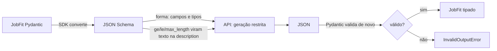
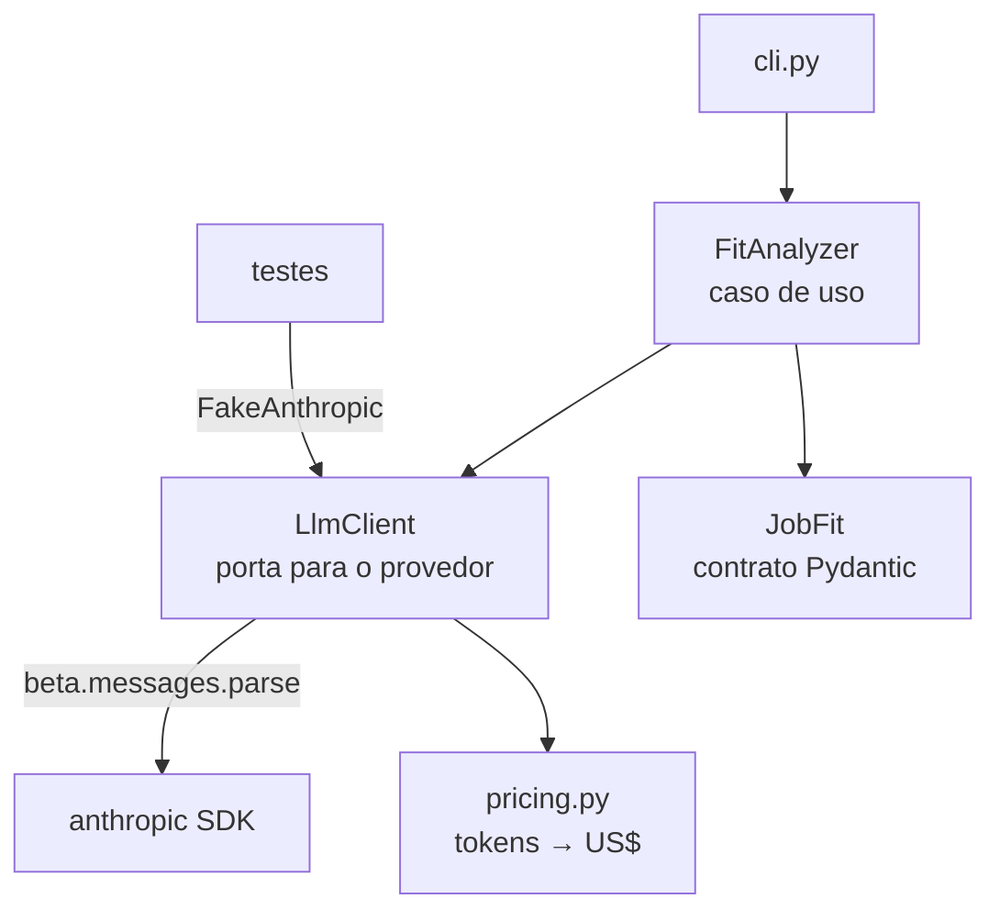

# Etapa 1 — Fundamentos de LLM: saída tipada, cache e custo por chamada

> Código: `src/ai_lab/llm/` (cliente e custo), `src/ai_lab/fit/` (caso de uso)
> Testes: `tests/test_pricing.py`, `tests/test_llm_client.py`, `tests/test_fit_*.py`, `tests/test_live.py`

---

## 1. O problema

Chamar um LLM é fácil. Usar a resposta num sistema é que dá trabalho:

```text
resposta = client.messages.create(...)   # devolve texto livre
score = int(resposta.split("score:")[1]) # quebra na primeira variação de formato
```

São quatro problemas:

| Problema | Sintoma |
|---|---|
| **Texto livre** | Parsing frágil, regex em cima de prosa |
| **Custo invisível** | Ninguém sabe quanto custa uma chamada até a fatura chegar |
| **Contexto repetido** | O mesmo currículo de 2.500 tokens é cobrado inteiro a cada pergunta |
| **Falhas silenciosas** | Recusa do modelo ou JSON cortado viram "resposta vazia" |

Caso de uso escolhido: **"o quanto meu currículo combina com esta vaga?"**. Ele junta as três peças de uma vez: um contexto grande e estável (o currículo), uma entrada pequena que muda (a vaga) e uma saída que precisa ser tipada (score, skills, lacunas).

---

## 2. As soluções

### 2.1 Saída estruturada com Pydantic

Analogia: é um **contrato de API**. Em vez de pedir "responda em JSON, por favor", você entrega o schema e a API **restringe a geração** para que só saia JSON válido naquele formato (constrained decoding).

Pydantic ≈ **record + Bean Validation** do Java:

```python
class JobFit(BaseModel):  # record JobFit(...)
    match_score: int = Field(ge=0, le=100)  # @Min(0) @Max(100)
    missing: list[str] = Field(max_length=15)  # @Size(max = 15)

    @model_validator(mode="after")  # @AssertTrue no nível da classe
    def skill_cannot_be_matched_and_missing(self): ...
```

O detalhe que pouca gente percebe (tem teste provando isso, `test_sdk_moves_constraints...`):



- A gramática **garante a forma**: campos obrigatórios, tipos, enum, nada de campo extra.
- **Não garante as regras**: `ge=0, le=100` vira só uma dica na `description`. O modelo quase sempre respeita, mas "quase sempre" não é contrato.
- Por isso o Pydantic valida **de novo do nosso lado**. É a mesma lógica de validar no back-end mesmo com validação no front.

### 2.2 Prompt caching

Analogia: um **PreparedStatement**. O banco compila a query uma vez e reaproveita o plano; aqui a API processa o prefixo uma vez e reaproveita.

Regra que governa tudo: **o cache é por prefixo**. Qualquer byte diferente no começo invalida tudo que vem depois.

```text
system[0]  instruções         ┐
system[1]  <resume>...</resume> ┘ estável → cache_control aqui (breakpoint)
messages   <job_posting>...    ← muda a cada chamada, fica depois do breakpoint
```

Os números (Opus 5.5, por 1M tokens):

| Tipo de token | Preço | Relativo |
|---|---|---|
| Entrada normal | US$ 4,00 | 1× |
| Escrita no cache (TTL 5 min) | US$ 5,00 | 1,25× |
| Leitura do cache | US$ 0,20 | 0,05× |

Já compensa a partir da **segunda** chamada: com 3.000 tokens de contexto, são US$ 0,024 sem cache e US$ 0,0156 com cache (`test_cache_pays_off_from_the_second_call`). No RAG da etapa 2 e nos evals da etapa 3, com dezenas de chamadas, a diferença vira ordem de grandeza.

Teste que protege isso: `test_system_prefix_is_identical_across_postings`. Se alguém colocar `datetime.now()` no system prompt, o cache morre em silêncio e o teste quebra.

### 2.3 Contagem de tokens e custo por chamada

- **Antes de chamar:** `count_tokens` (endpoint gratuito) + `max_tokens` dão o **pior caso**. Se passar de `LAB_MAX_COST_PER_CALL_USD`, a chamada nem sai (`BudgetExceededError`). É o primeiro guardrail de custo; a etapa 5 o expande.
- **Depois de chamar:** `response.usage` separa entrada, saída, escrita e leitura de cache. `pricing.py` converte em dólar com `Decimal` (≈ `BigDecimal`).

Três armadilhas que o código trata:

1. **Saída custa 5× a entrada.** No pior caso, o `max_tokens` domina o custo. Ele é o seu teto de gasto, não só um limite técnico.
2. **Pensamento é cobrado como saída.** O Opus 5.5 sempre pensa antes de responder, mesmo quando o texto do raciocínio não volta. `effort=low` reduz isso para tarefas de extração.
3. **Modelo desconhecido falha alto.** Custo zero silencioso esconderia gasto real (`UnknownModelPriceError`).

### 2.4 Falhas explícitas

| Situação | `stop_reason` | O que o código faz |
|---|---|---|
| Resposta normal | `end_turn` | Devolve `LlmResult[JobFit]` |
| Classificador de segurança recusou | `refusal` | `RefusalError(category)`, nunca resposta vazia |
| JSON cortado pelo `max_tokens` | `max_tokens` | `InvalidOutputError` |
| Regra de negócio violada | `end_turn` | `InvalidOutputError` |

Além disso, o cliente liga o **fallback no servidor** (`fallbacks: "default"`): se o modelo recusar, a própria API refaz a chamada noutro modelo, escolhido pela categoria da recusa. Consequência para custo: uma chamada pode ter **dois modelos com dois preços**. Por isso o custo é calculado por `usage.iterations` e o resultado informa `served_by` (`test_fallback_bills_each_model_at_its_own_price`).

---

## 3. Arquitetura



`LlmClient` é o equivalente a uma **porta na arquitetura hexagonal**: é o único lugar que conhece as manias do provedor (beta de fallback, layout do cache, recusas). Os testes trocam o SDK por um fake que **usa o parser real do SDK**. Se o SDK mudar o formato da resposta, o teste quebra; só o HTTP é falso.

---

## 4. Como rodar

```bash
uv sync
uv run pytest                     # 23 testes, sem rede, custo zero
uv run ai-lab estimate data/samples/senior-ai-engineer.md   # só conta tokens: gratuito
uv run ai-lab fit data/samples/senior-ai-engineer.md --repeat 2
uv run pytest --live              # 2 chamadas reais
```

Custo estimado das chamadas reais (Opus 5.5, `effort=low`): **US$ 0,02 a 0,05 por chamada**. Na segunda chamada, procure `cache_read` maior que zero.

---

## 5. Trade-offs

| Decisão | Ganho | Custo |
|---|---|---|
| `messages.parse` do SDK | Schema gerado e validação automáticos | Valida **antes** de vermos o `stop_reason`: JSON cortado e regra violada chegam como o mesmo erro |
| Fallback no servidor ligado | Recusa vira resposta, sem código extra | API beta; uma chamada pode custar o preço de outro modelo |
| Opus 5.5 como padrão | Melhor qualidade de raciocínio | ~40× mais caro que o Haiku 5.5 por token. Troque com `LAB_MODEL` e meça nos evals da etapa 3 antes de decidir |
| Cache de 5 min | Escrita a 1,25× | Se o intervalo entre chamadas passar de 5 min, paga a escrita de novo. O TTL de 1 h custa 2× na escrita |
| Wrapper próprio em vez de LangChain aqui | Vê-se cada campo da API | Mais código. O LangChain entra na etapa 2, onde ele resolve um problema de verdade (loaders, splitters, retrievers) |

## 6. Alternativa descartada

**"Responda em JSON" no prompt + `json.loads`.** Funciona em 95% das vezes, e esse é o problema: os 5% restantes aparecem em produção como `JSONDecodeError` às 3 da manhã (texto antes do JSON, vírgula sobrando, campo com outro nome). Com geração restrita, a forma é garantida pela API; sobra validar só as regras de negócio.

**Quando o JSON no prompt ainda faz sentido:** modelos ou provedores sem saída estruturada, ou quando você precisa de **citações**. Citações e `output_config.format` são incompatíveis (a API devolve 400), e isso vai pesar na etapa 2.

---

## 7. O que levar desta etapa

1. **Forma ≠ regra.** A API garante a forma; as regras você valida.
2. **Cache é prefixo.** Estável em cima, variável embaixo. Um teste protege isso.
3. **`max_tokens` é teto de custo.** Calcule o pior caso antes de chamar.
4. **Recusa não é resposta vazia.** Trate o `stop_reason` antes de ler o conteúdo.
