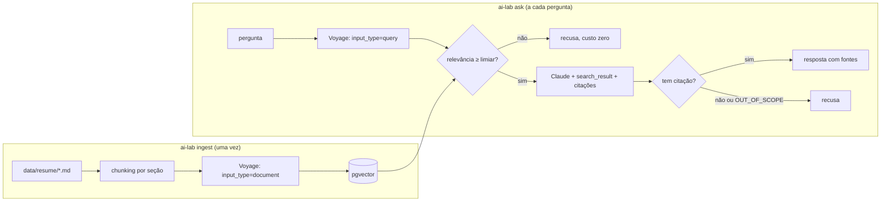

# Etapa 2 — RAG com citações: "Ask my resume"

> Código: `src/ai_lab/rag/` (chunking, retrieval, assistant, store), `docker/`
> Testes: `tests/test_chunking.py`, `tests/test_retrieval.py`, `tests/test_assistant.py`,
> `tests/test_pgvector_integration.py`, `tests/test_live.py`

---

## 1. O problema

Um recrutador pergunta: *"Ele já trabalhou com mensageria?"*. Três jeitos de responder:

| Jeito | O que acontece |
|---|---|
| Perguntar direto ao modelo | Ele não conhece o Robson. **Inventa** algo plausível |
| Colar o currículo inteiro no prompt | Funciona com um currículo. Não escala para centenas de documentos, não diz **de onde** tirou a resposta e responde até o que não está lá |
| **RAG** | Busca só os trechos relevantes, responde com **citação** de cada um e **recusa** o que não está nos documentos |

Analogia: **prova com consulta e professor rigoroso**. O modelo recebe só as páginas que importam, precisa apontar a linha que sustenta cada frase, e "não está no livro" é uma resposta válida. Resposta sem apontar a fonte vale zero.

---

## 2. O fluxo



São três barreiras contra resposta inventada, cada uma num lugar diferente:

1. **Limiar de relevância** (código, antes do LLM): nenhum trecho parecido o bastante → recusa sem gastar token.
2. **Instrução** (prompt): os resultados não respondem → o modelo devolve exatamente `OUT_OF_SCOPE`.
3. **Regra de grounding** (código, depois do LLM): resposta **sem nenhuma citação** é descartada (`Outcome.NO_CITATIONS`).

A terceira é a mais importante: não depende de o modelo obedecer. É o mesmo princípio da etapa 1 ("forma não é regra"): o que importa, você confere no código.

---

## 3. As decisões

### 3.1 Chunking por seção, com o cabeçalho junto

Analogia: indexar um livro por capítulo e seção, não "a cada 500 caracteres".

- `MarkdownHeaderTextSplitter` corta por `#`, `##` e `###` → **um chunk por emprego, projeto ou seção** (15 no currículo).
- Seções longas são subdivididas (`RecursiveCharacterTextSplitter`, 1.200 caracteres, sobreposição de 150).
- **Cabeçalho contextual:** o texto do chunk começa com `Experience > Senior Software Engineer — technology consultancy (...)`. Sem isso, um chunk dizendo "Led code reviews" não sabe de qual emprego é, nem para o embedding nem para a citação.
- **Ids determinísticos** (`uuid5` de fonte + seção + conteúdo): reingerir o mesmo texto vira **upsert**, não duplica (teste `test_reingesting_the_same_chunks_does_not_duplicate`, no pgvector real). É a idempotência do bank-resilience-lab aplicada à ingestão.

### 3.2 Embeddings: Voyage `voyage-4-lite`, 512 dimensões

| | Voyage (escolhido) | Local (sentence-transformers) |
|---|---|---|
| Custo | US$ 0,02/M tokens, 200M grátis (o currículo tem ~3 mil) | Zero |
| Instalação | Um pacote leve | PyTorch, centenas de MB |
| Deploy em Lambda (etapa 6) | Zip pequeno | Imagem de container, cold start maior |
| Pergunta × documento | `input_type=query` e `document` (o `langchain-voyageai` faz sozinho) | Depende do modelo |
| Rede | Precisa | Offline |

**512 dimensões em vez de 1024:** metade do armazenamento e da conta de distância. Para 15 chunks a diferença de qualidade é irrelevante; os evals da etapa 3 dizem se não for.

### 3.3 pgvector, e a armadilha do "score"

pgvector é uma extensão do Postgres: a tabela ganha uma coluna `vector(512)` e um operador de distância. Combina com o RDS que você já opera.

**A armadilha:** cada store devolve um "score" com significado diferente.

| Store | `similarity_search_with_score` devolve | Melhor é |
|---|---|---|
| pgvector (cosseno) | **distância** | menor |
| InMemoryVectorStore | **similaridade** | maior |

Um limiar `score >= 0.4` funcionaria num e faria o contrário no outro. Por isso o `Retriever` usa `similarity_search_with_relevance_scores`, que normaliza tudo para **0 a 1, maior é melhor**. O store em memória do LangChain nem declara essa conversão (lança `NotImplementedError`), e os testes declaram (`CosineInMemoryStore`).

**Driver `asyncpg`:** o `PGVectorStore` é assíncrono por dentro. O psycopg assíncrono não roda no event loop padrão do Windows (`ProactorEventLoop`); o asyncpg roda em qualquer sistema.

### 3.4 Citações nativas do Claude (`search_result`)

Cada chunk recuperado vai como um bloco `search_result` com `citations: {enabled: true}`. A API devolve a resposta em blocos de texto, e cada bloco traz `source`, `title` e o `cited_text` exato que o sustenta.

**Por que não saída estruturada aqui:** citações e `output_config.format` são incompatíveis (a API devolve 400). Na etapa 1 o contrato era o JSON; aqui o contrato são as **citações**, e por isso o código as confere.

### 3.5 Onde o LangChain entra, e onde não

| Peça | Usa LangChain? | Por quê |
|---|---|---|
| Splitters | Sim | Resolver Markdown e sobreposição na mão é reinventar a roda |
| Embeddings e vector store | Sim | Interface `Embeddings`/`VectorStore` trocável: Voyage ↔ falso, pgvector ↔ memória, sem mudar o `Retriever` |
| Geração com citações | **Não**: SDK da Anthropic via `LlmClient` | As citações `search_result` são específicas do provedor; o `LlmClient` já trata recusa, fallback e custo |

É o papel de um framework de integração (≈ Spring Integration): usar onde ele padroniza, não onde ele esconde o que você precisa ver.

---

## 4. Como rodar

```bash
docker compose -f docker/docker-compose.yml up -d    # pgvector na porta 5435
python -m uv run pytest                              # 39 testes; os de integração sobem um pgvector próprio
python -m uv run pytest -m integration               # só os de pgvector (precisa do Docker)

# com ANTHROPIC_API_KEY e VOYAGE_API_KEY no .env:
python -m uv run ai-lab ingest
python -m uv run ai-lab ask "Has he worked with event streaming?" --show-context
python -m uv run ai-lab ask "What is his favorite food?" --show-context
python -m uv run pytest --live                       # 3 chamadas ao Claude, ~US$ 0,05-0,10
```

`--show-context` mostra cada trecho recuperado com a relevância e se passou do limiar. **Depure a recuperação separada da geração:** se a resposta está ruim, primeiro descubra se o trecho certo chegou ao modelo.

Custo por pergunta (Opus 5.5, `effort=low`, 4 chunks): cerca de **US$ 0,01 a 0,03**. Pergunta recusada pelo limiar: **zero**.

---

## 5. Trade-offs

| Decisão | Ganho | Custo |
|---|---|---|
| Limiar fixo de relevância (0,40) | Recusa barata, antes do LLM | O número certo depende do modelo de embedding. Chutado agora; **calibrado com os evals da etapa 3** |
| Resposta sem citação é descartada | Grounding garantido no código | Pode recusar uma resposta correta em que o modelo esqueceu de citar (os evals medem quantas) |
| Ingestão recria a tabela | Simples e sempre consistente | Inviável com milhões de chunks; aí entra ingestão incremental por hash de conteúdo (a API de indexing do LangChain faz isso) |
| Sem cache no contexto recuperado | — | Os trechos mudam a cada pergunta; só as instruções são estáveis, e são curtas demais para o mínimo de cache. Em escala: cachear um prefixo maior (ex.: resumo fixo do perfil) |
| Busca só vetorial | Pega sinônimos ("event streaming" ≈ Kafka) | Perde termos exatos raros (siglas, nomes de projeto). Alternativa: busca híbrida (vetor + texto), que o `PGVectorStore` suporta |

## 6. Alternativa descartada

**Currículo inteiro no prompt, sem RAG.** Com ~3 mil tokens, isso funcionaria, e com cache sairia barato. Foi descartado porque não ensina nem escala: não cita a fonte, não recusa com critério e não aguenta quando o corpus crescer (projetos, artigos, READMEs). **Quando ele é a escolha certa:** corpus pequeno e fixo, sem exigência de citação. Saber dizer "aqui não precisa de RAG" é uma resposta sênior de entrevista.

---

## 7. O que levar desta etapa

1. **Três barreiras contra invenção:** limiar antes, instrução durante, citação obrigatória depois. Só a última não depende do modelo.
2. **Chunk precisa fazer sentido sozinho.** Corte por estrutura e leve o cabeçalho junto.
3. **"Score" não é universal.** Distância ou similaridade? Normalize antes de comparar com um limiar.
4. **Depure a recuperação separada da geração.**
